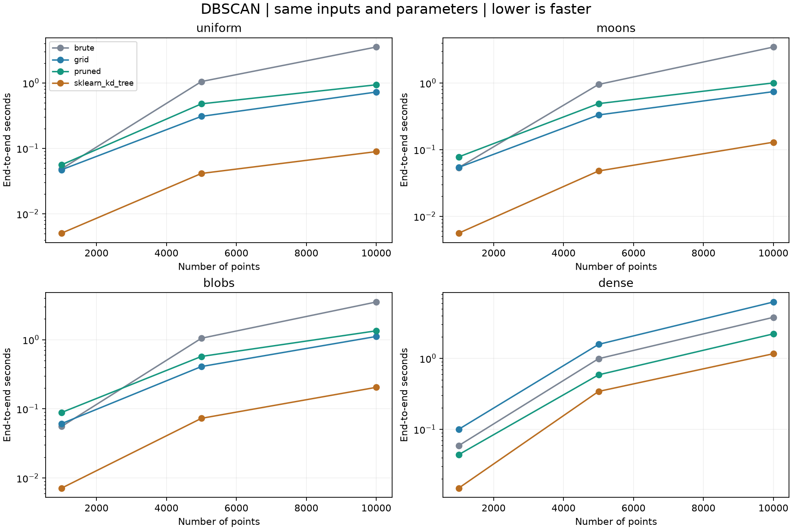

# 基于网格索引与几何剪枝的 DBSCAN 聚类加速

第 2 周课题：在经典算法上实现并验证改进。代码、数据、实验、演示和四页讲义已完成。

研究问题：在二维欧氏点集上，网格索引和点集包围盒能否减少邻域查询开销，同时保持 DBSCAN 的聚类结果？

**实测结论：网格与剪枝存在适用条件。** 24 份独立数据、288 次计时中，四种实现的聚类分区、核心点和噪声点全部一致。仅网格和网格加剪枝相对全量扫描的总体几何平均加速比均约 1.64 倍；加入剪枝相对仅网格约 1.001 倍，总体基本持平。剪枝在本轮全部 6 份高密度数据上更快，在其余 18 份数据上更慢。减少距离次数不能直接推出减少运行时间。

## 先看演示与讲义

- [交互演示](outputs/demo/demo.html)：自包含 HTML，无网络请求；选择数据、查询点和方法，播放聚类扩展。
- [四页算法讲解与代码演示](docs/DBSCAN算法讲解与代码演示.docx)：沿用第一周保存的通用模板版式。
- [完整实验报告](outputs/validation/实验报告.md)：全部规模与分布的四组对照。
- [独立验证记录](docs/验证记录.md)：正确性、审计、内存方法与文档检查。
- [十点手算结果](outputs/micro/micro.json)：逐点邻居集合及预期标签。

原始模板的旧路径目前不存在，本周文档以已保存的第一周讲义作为版式参考；第一周文件保持原样。

## 运行

在工作区根目录 `D:\PythonProject\TwoTypeCommon` 的 PowerShell 中：

```powershell
.\算法\02_DBSCAN网格加速\run.cmd test
.\算法\02_DBSCAN网格加速\run.cmd demo
.\算法\02_DBSCAN网格加速\run.cmd micro
.\算法\02_DBSCAN网格加速\run.cmd verify
```

`run.cmd` 优先使用工作区根目录的 `.venv`，否则使用 PATH 中的 Python。生成的演示可直接双击打开。工具验证使用了本机回环 HTTP 服务，页面本身无外部资源或 fetch 依赖。

下面命令在本算法目录执行。正式实验目录不会被覆盖，复跑请使用新目录：

```powershell
# 小规模完整流程
.\run.cmd benchmark --config configs/quick.json --out outputs/my_quick

# 正式规模：4 分布 × 3 规模 × 2 实例 × 4 方法 × 3 次
.\run.cmd benchmark --config configs/validation.json --out outputs/my_validation
.\run.cmd verify --results outputs/my_validation

# 内存另测，每族选择第一份 5000 点实例
.\run.cmd memory --results outputs/my_validation --size 5000

# 对自己的数据聚类，输出文件必须尚不存在
.\run.cmd cluster --csv outputs/micro/points.csv --eps 0.2 --min-samples 4 --method pruned --out outputs/my_labels.json
```

核心代码仅需 NumPy；对照、制图、内存测量分别需 scikit-learn、Matplotlib、psutil。本机已有依赖，版本见 [requirements.txt](requirements.txt)。新环境可用该环境的 `python -m pip install -r requirements.txt`。讲义重建工具另用文档运行环境的 lxml，不是算法运行依赖。

## 问题定义

输入为二维有限坐标 `points[n,2]`、正半径 `eps` 和正整数 `min_samples`。CSV 格式为 `id,x,y`，编号从 0 连续；坐标重复合法，每行代表一个样本。三个手写版本支持形状为 `(0,2)` 的空输入；正式对照使用非空输入。

邻域为闭球，包含查询点自身：

\[
N_\varepsilon(p)=\{q: \|p-q\|_2\le\varepsilon\},\qquad
\mathrm{core}(p)\iff |N_\varepsilon(p)|\ge m.
\]

只有核心点可以继续扩展。边界点属于某个簇但不继续扩展；未连到核心点的非核心点为噪声。暂标噪声的点之后可能成为边界点。多个簇都能接触到的边界点由先到达的簇接纳，因此固定原始点与邻居顺序。

输出 `labels` 中 `-1` 为噪声，`0,1,…` 为簇编号；运行中的 `-2` 代表尚未分配，最终不会保留。`core` 单独标识核心点。“结果一致”指同一参数下不同实现等价，不代表参数必然符合真实业务分类。

## 三个手写版本与一个成熟参照

| 名称 | 邻域查询 | 作用 |
|---|---|---|
| `brute` | 每次扫描全部点 | 朴素基准 |
| `grid` | 网格筛选候选，再精确算距离 | 检验网格本身的收益 |
| `pruned` | 网格＋点集包围盒的上下界 | 检验额外几何剪枝 |
| `sklearn_kd_tree` | scikit-learn DBSCAN，显式 KDTree | 成熟实现的实际性能参照 |

三个手写版本共用 `numpy.hypot(dx,dy) <= eps` 距离核和 `fit()` 队列扩展代码，不缓存完整邻域图。NumPy 只处理数组运算，聚类与索引逻辑由本项目实现。库参照固定 `algorithm="kd_tree"`、`leaf_size=40`、`metric="euclidean"`、`n_jobs=1`。底层优化不同，库的速度差距不能全部归因于索引策略。

### 网格查询

网格边长为 ε，点的网格坐标为 `(floor(x/ε), floor(y/ε))`。精确实数运算下，邻居只会位于当前格及周围八格：某一维隔了两格，该维距离便超过 ε。

浮点实现需处理临界位置。例如极小的负数与 `1.0` 的差可舍入为 `1.0`，但格编号相差 2。程序用整数比计算网格编号，对查询范围做保守浮点外扩；通常查询九格，临界位置可能多查边缘格。极端坐标/ε 比例使范围跨过过多编号时，回退为扫描所有非空格。最终逐点判断仍为 `hypot <= eps`，不放宽邻域阈值。

### 包围盒剪枝

每个非空格记录实际点集的轴对齐包围盒 `B=[aₓ,bₓ]×[aᵧ,bᵧ]`。对于查询点 `p=(x,y)`：

\[
u_x=\max(a_x-x,0,x-b_x),\quad u_y=\max(a_y-y,0,y-b_y),\quad
d_{\min}=\sqrt{u_x^2+u_y^2}.
\]

\[
v_x=\max(|x-a_x|,|x-b_x|),\quad v_y=\max(|y-a_y|,|y-b_y|),\quad
d_{\max}=\sqrt{v_x^2+v_y^2}.
\]

对包围盒内任一点 q，都有 `d_min ≤ d(p,q) ≤ d_max`：

- `d_min > ε`：所有点在圆外，整格排除。
- `d_max ≤ ε`：所有点在圆内，整格接纳。
- 其他情况：逐点判断。

程序将外部阈值向外扩展、内部阈值向内收紧两个相邻浮点值，只在远离临界时直接排除或接纳；临界情况交回相同距离核。测试覆盖等于 ε、前后一个浮点值、次正规数与极端坐标比例。几何证明针对实数关系；浮点行为另用独立查询核与边界案例验证，不声称穷举全部 IEEE-754 输入。

邻居集合一致，则核心点判定一致；相同访问顺序和扩展过程给出相同分区与噪声。测试还使用独立的“先求核心点连通分量，再分配边界点”的图方法核对，不只在共享实现之间比较。

## 十点手算

`eps=0.2`、`min_samples=4`。前四点为 `(0,0)、(0.1,0)、(0,0.1)、(0.1,0.1)`；点4为 `(0.28,0)`；点5–8为前四点平移 `(2,2)`；点9为 `(5,5)`。

- 点0–3均为核心点，组成簇0；点4的邻居只有自身和点1，是簇0的边界点。
- 点5–8均为核心点，组成簇1。
- 点9仅有自身，未连接核心点，为噪声。

期望标签为 `[0,0,0,0,0,1,1,1,1,-1]`。演示中的“十点手算”与 JSON 保留所有邻居列表。

## 实验设计与结果

开发集使用种子 `20261029` 派生，规模500/2000，每例计时两次。第一轮保留在 `outputs/development`；第二轮只将包围盒的 NumPy 标量调用改为 `math.hypot`，保留在 `outputs/development_v2`。两轮各64次，均保留小数据上的负收益。

正式集使用独立种子 `20271129`、`20271229` 派生，4分布×3规模×2实例，共24份。四种实现各测三次，共288次。整数种子是标识，不代表运行日期。输入、参数及源码哈希在正式计时前固定，之后未据验证结果调整算法。

计时含校验、建立网格/包围盒、查询、排序和扩展，排除导入、生成、比较和保存。先预热，每轮随机方法顺序。每例三次取中位数，再对配对加速比取几何平均；有限重复不用于显著性结论。

| 方法 | 相对扫描总体加速比 | 比扫描快的实例 |
|---|---:|---:|
| 全量扫描 | 1.000× | 基准 |
| 仅网格 | 1.639× | 14/24 |
| 网格＋剪枝 | 1.641× | 18/24 |
| scikit-learn KDTree | 11.123× | 24/24 |

10,000点时，时间为两份实例中位数的平均，单位秒：

| 分布 | 全量扫描 | 仅网格 | 网格＋剪枝 | KDTree | 剪枝相对仅网格 |
|---|---:|---:|---:|---:|---:|
| 均匀散点 | 3.5327 | 0.7249 | 0.9354 | 0.0892 | 0.765× |
| 双月形 | 3.4705 | 0.7430 | 1.0041 | 0.1294 | 0.740× |
| 多个团块 | 3.5010 | 1.1114 | 1.3415 | 0.2046 | 0.828× |
| 高密度退化 | 3.7852 | 6.2275 | 2.2136 | 1.1623 | 2.812× |

加速比大于1表示更快，小于1表示更慢。配对比的几何平均不等于直接相除跨实例平均时间。

均匀数据中，网格已排除大量远点，再做矩形判断未必划算。高密度退化数据全部点在一个格内且互为邻居，剪枝可整格接纳，点对距离次数降为0，但仍须枚举n²个邻居。“距离计数归零”不代表“线性时间”。矩形的上下界距离另记为 `box_checks`，不计入点对距离次数。



### 内存

每种实现每份输入用新的解释器进程，导入依赖和加载输入后记RSS基线，在fit期间采样真实工作进程。四族各选首份5000点实例，每种方法测一次，明细见 [memory.csv](outputs/validation/memory.csv)，与计时独立。

5000点高密度例，剪枝版采样额外RSS约 **0.50 MiB**，库参照约 **354.60 MiB**。库实现批量保存邻域，手写实现逐点查询。数值受分配器和采样间隔影响，是本机观察，不是严格峰值或普遍上界；不同的导入后基线也不能忽略。

Windows虚拟环境启动器和解释器PID可能不同。最初监测启动器的无效记录仅保留在 `memory_diagnostic_v1`，不参与结论。正式采样使用子进程自报PID，并记录Windows原生生命周期峰值交叉检查。

## 复杂度与范围

第i次查询有 `cᵢ` 个候选、返回 `kᵢ` 个邻居。网格建立通常为O(n)；查询和扩展包括候选处理、邻居枚举和编号排序。按当前NumPy introsort，排序保守计为O(kᵢ log kᵢ)。普通固定精度分析下：

\[
O\!\left(n+\sum_i(c_i+k_i\log(k_i+1))\right).
\]

极端回退还需扫描最多n个非空格。密集时仍有Θ(n²)邻居条目，含排序的保守时间上界O(n² log n)，不声称近线性；扫描版O(n²)。默认不存演示帧，索引、队列与单次邻居的额外空间O(n)。记录完整标签帧会增加到O(n²)，因此演示只用小例子。上述固定精度分析将Python整数比的位运算成本视为常数。

仅支持二维欧氏距离、无样本权重；不处理经纬度球面距离，不直接推广到高维。固定区域和ε时，n增加也使平均邻居数增加，三档规模不能证明一般渐近复杂度。

## 代码与讲解

| 文件 | 用途 |
|---|---|
| `dbscan.py` | 手写聚类、网格、矩形剪枝、成熟参照 |
| `datasets.py` | 固定分布、参数与CSV |
| `experiments.py` | 冻结协议、计时、核对、汇总、绘图 |
| `visualization.py` / `demo_template.html` | 手算与离线交互 |
| `tests/test_algorithm.py` | 20项测试及独立图参考 |
| `tools/verify_results.py` | 哈希、288次抽样查询及汇总复算 |
| `tools/measure_memory.py` | 独立解释器RSS采样 |
| `tools/build_handout.py` | 保留参考版式的讲义生成 |

建议45分钟：十点案例8分钟，网格与上下界10分钟，代码演示12分钟，实验与退化10分钟，讨论“次数更少为何仍更慢”5分钟。

后续可研究按网格占用量选择是否做矩形判断。应在新开发集选策略，再用新验证集评估；本轮保持当前三种方法的完整结果。

## 依据

- [DBSCAN API](https://scikit-learn.org/stable/modules/generated/sklearn.cluster.DBSCAN.html)：参数和内存行为。
- [DBSCAN 原理说明](https://scikit-learn.org/stable/modules/clustering.html#dbscan)：核心点、边界点和访问顺序。
- [Huang 等，GriT-DBSCAN，2022](https://arxiv.org/abs/2210.07580)：已有网格与剪枝研究。本项目未实现其grid tree，不沿用其复杂度结论。
- [NumPy 排序说明](https://numpy.org/doc/stable/reference/generated/numpy.sort.html)：默认quicksort采用introsort的实现说明。

项目定位是经典算法的实现、消融与适用条件研究，不宣称原创聚类方法或普遍领先于成熟库。
